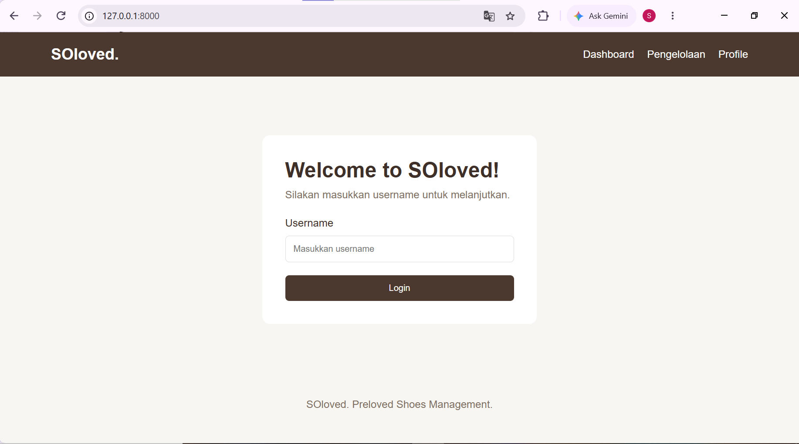
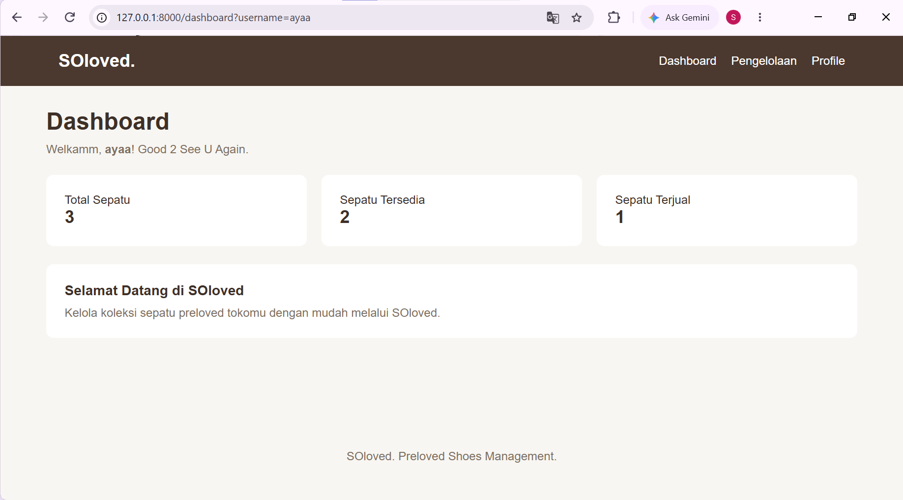
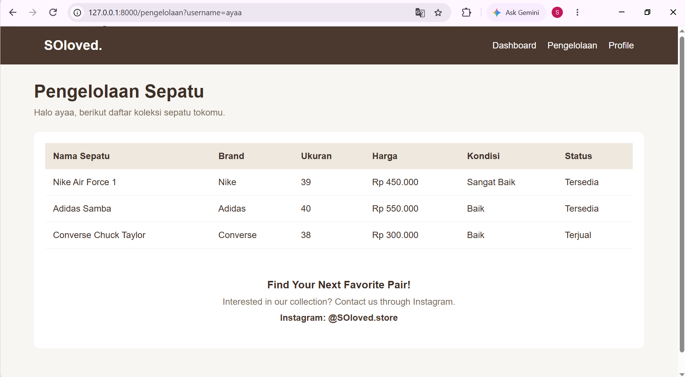
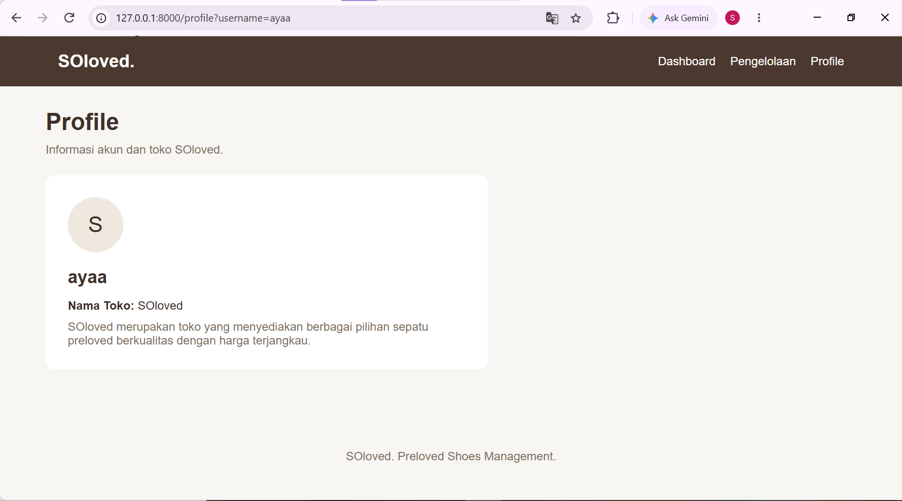

Saya membuat website SOloved, yaitu website sederhana untuk pengelolaan toko sepatu preloved. Website ini memiliki beberapa halaman, yaitu Login, Dashboard, Pengelolaan, dan Profile. Fitur utama website ini meliputi login pengguna, menampilkan ringkasan data sepatu pada dashboard, melihat daftar sepatu beserta detailnya seperti nama, brand, ukuran, harga, kondisi, dan status, serta menampilkan informasi profil toko.

## Screenshot Website

**1. Halaman Login**

**2. Halaman Dashboard**

**3. Halaman Pengelolaan**

**4. Halaman Profile**

